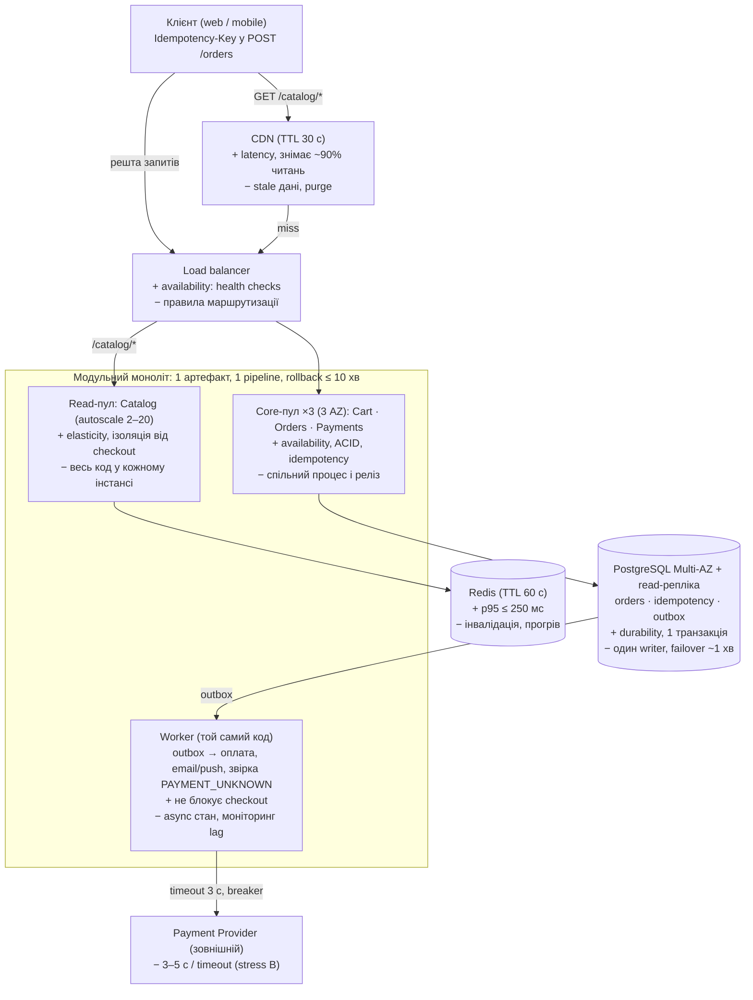
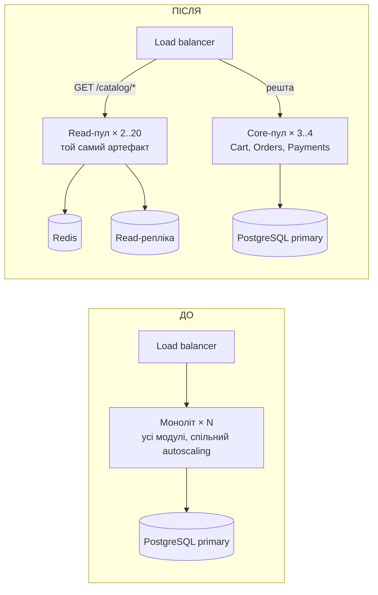
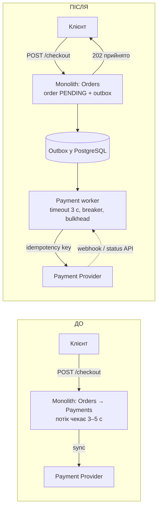
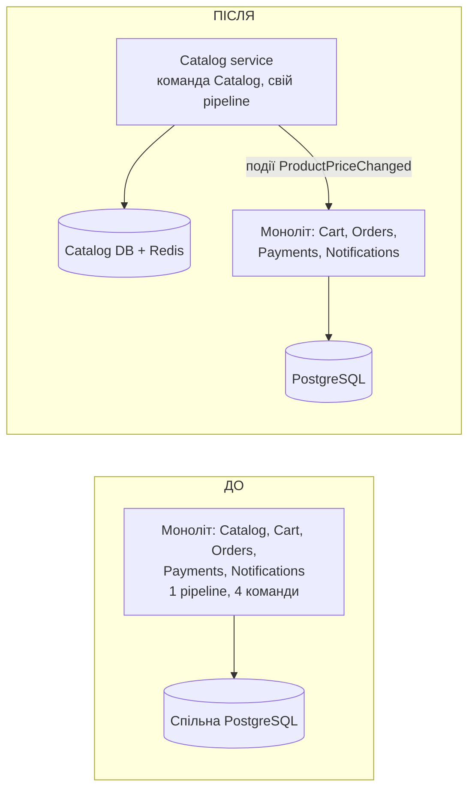

# Практична робота 2. Архітектурні характеристики, trade-offs та вимірювані сценарії

**Коротко:** для першого релізу FlashShop я обираю **Варіант А — модульний моноліт** зі stateless-екземплярами, кешем read-моделі каталогу, однією керованою PostgreSQL з репліками для читання, transactional outbox і окремим worker для фонових задач. Головні drivers — доступність і надійність checkout, еластичність під flash-sale, deployability і простота експлуатації для команди з 7 осіб. Варіант Б краще масштабує Catalog незалежно, але цю перевагу на 60 с stale-вікні майже повністю закриває кеш, а ціну розподіленої системи команда платила б одразу.

> Позначення: **\[У\]** — факт з умови задачі, **\[П\]** — моє припущення.

## 1. Класифікація вимог і обмежень (рівень 60)

Класифіковано 16 тверджень. Число саме по собі не робить твердження архітектурною характеристикою: вирішує, чи описує воно властивість системи (як добре), зовнішню межу рішення (чим ми обмежені) чи поведінку (що робить).

| # | Твердження з умови | Клас | Пояснення для спірних випадків |
| --- | --- | --- | --- |
| 1 | Користувач переглядає каталог, працює з кошиком, оформлює і оплачує замовлення, бачить його стан | Functional requirement | — |
| 2 | Рекомендації та email/push-сповіщення | Functional requirement (допоміжна) | Сама функція — functional; але її «допоміжність» впливає на рядок 9. |
| 3 | 1 200 000 зареєстрованих користувачів | Assumption / context | Сама кількість акаунтів нічого не вимагає; важлива лише для обсягу даних і кешу сесій. |
| 4 | Звичайне навантаження \~300 req/s; пік до 6 000 req/s на 15–20 хв (5 000 каталог / 700 кошик / 300 checkout) | Assumption / context (профіль навантаження) | Спірне: це не характеристика, а умова середовища. Характеристики elasticity й scalability виводяться з нього (20× стрибок, 83% — читання). |
| 5 | Catalog p95 ≤ 250 мс за 5 000 read req/s | Architectural characteristic (performance / scalability) | Є stimulus, умова і міра — вже майже quality scenario. |
| 6 | Checkout p95 ≤ 800 мс до однозначного результату або «прийнято в обробку» за 250 req/s | Architectural characteristic (performance + responsiveness) | Формулювання «прийнято в обробку» прямо дозволяє асинхронну оплату. |
| 7 | Доступність checkout ≥ 99,95% на місяць (без повної відмови провайдера) | Architectural characteristic (availability) | ≈ 21,9 хв недоступності на місяць; один ручний інцидент їх вичерпує. |
| 8 | Каталог може бути застарілим до 60 с | Architectural characteristic (допустима consistency) | Спірне: це послаблення вимоги, але воно визначає архітектуру: саме воно дозволяє кешувати каталог з TTL. |
| 9 | Рекомендації/сповіщення можуть бути недоступні й не блокують checkout | Architectural characteristic (fault isolation / graceful degradation) | Вимагає асинхронності або таймаутів з fallback на цих викликах. |
| 10 | Замовлення і відомий результат платежу не зникають після перезапуску; падіння екземпляра — без ручного втручання | Architectural characteristic (reliability / durability, recoverability) | — |
| 11 | Повтор запиту через timeout не створює дубль замовлення | Architectural characteristic (reliability / data integrity) | Спірне: звучить як бізнес-правило, але реалізується лише архітектурно (idempotency key, унікальний індекс) і стосується всіх точок входу. |
| 12 | Дані карток не зберігаються, лише токени провайдера | Constraint (+ знижує вимоги security) | Рішення, яке вже прийнято; виводить систему з найсуворішої частини PCI DSS. |
| 13 | 7 розробників, 4 місяці, слабкий досвід розподілених систем | Constraint / context | Не maintainability. Лише підвищує вагу характеристики «простота експлуатації». |
| 14 | Один cloud-region; обмежений бюджет, не тримати ресурси під абсолютний пік | Constraint | Регіон ставить стелю для availability (захист лише від відмови зони). Бюджет робить elasticity важливішою за статичний headroom. |
| 15 | ≥ 3 production-deployments на тиждень; rollback ≤ 10 хв | Architectural characteristic (deployability) | Частота релізів — ціль команди, але rollback ≤ 10 хв — властивість системи (впливає на міграції БД). |
| 16 | Секрети не в репозиторії; адмін-операції автентифіковані та журналюються | Architectural characteristic (security / auditability) | «Секрети не в репо» майже constraint (інженерна практика), аудит адмін-дій — властивість системи. |

## 2. Пріоритетні architectural characteristics (рівень 60)

Для першого релізу обрано п'ять drivers. Порядок — від найдорожчого провалу до найдешевшого. Security (секрети, аудит адмін-дій) — обов'язкова базова вимога, але не driver: обидва варіанти виконують її однаково, тому вона не впливає на вибір між ними.

| # | Характеристика | Чому важлива саме тут | Що станеться, якщо не виконати | З чим конфліктує |
| --- | --- | --- | --- | --- |
| 1 | **Reliability / data integrity checkout** (durability замовлення, ідемпотентність) | Під час flash-sale клієнти масово повторюють запит через повільні відповіді та timeout \[У\]. Підтверджене замовлення не може зникнути \[У\]. | Дублі замовлень і подвійні списання або «втрачені» оплачені замовлення: прямі гроші, chargeback, скарги. Це не лікується масштабуванням. | З performance (синхронний commit у БД, перевірка ключа ідемпотентності додають латентність); з elasticity (БД записів масштабується лише вертикально). |
| 2 | **Availability checkout** ≥ 99,95% / місяць | Продажі зосереджені у 15–20 хв піку; хвилина простою в пік коштує як години звичайного дня \[П\]. Бюджет помилок ≈ 21,9 хв/міс. | Втрачений виторг саме тоді, коли кампанія вже оплачена (реклама). Один інцидент з ручним втручанням вичерпує місячний бюджет. | З cost (≥ 2 екземпляри + Multi-AZ БД постійно); з одним регіоном \[У\] — від падіння регіону не захищаємось; з deployability (кожен деплой — ризик). |
| 3 | **Elasticity + performance каталогу під піком** (p95 ≤ 250 мс @ 5 000 rps) | Навантаження зростає у 20 разів за хвилини, з них 83% — читання каталогу \[У\]. Тримати ресурси під пік постійно не можна \[У\]. | Каталог «лягає» першим і тягне за собою спільні ресурси (пул з'єднань БД, CPU) — падає й checkout. | З consistency (кеш показує дані до 60 с давності); з cost (autoscaling потребує запасу на час розгону); з простотою (прогрів кешу, інвалідація). |
| 4 | **Deployability** (≥ 3 деплої/тиждень, rollback ≤ 10 хв) | Короткі кампанії вимагають частих змін (ціни, банери, правила знижок) \[П\]; критичний дефект у пік треба відкотити до кінця піку. | Або команда боїться деплоїти (зростають батчі змін і ризик), або дефект живе весь flash-sale. | З availability (зміни — головне джерело інцидентів); з data integrity (міграція схеми БД ламає rollback, якщо вона не backward-compatible). |
| 5 | **Operational simplicity** (простота експлуатації) | 7 розробників, 4 місяці, малий досвід розподілених систем \[У\]; немає окремої SRE-команди \[П\]. | Команда не встигне до релізу або не зможе діагностувати інцидент у пік — тоді провалюються №2 і №1. | З independent scalability (менше deployables = масштабуємо разом); з independent delivery (з'явиться при рості команди — stress C). |

Ключове спостереження: характеристики 1–3 мають різну природу для різних частин системи. Каталог — це read-heavy, допускає stale data, потребує еластичності. Checkout — write-path з малою інтенсивністю (300 rps), але з найвищими вимогами до коректності. Тому архітектура має **розвести ці два шляхи за ресурсами**, але не обов'язково за deployment units. 

## 3. Вимірювані quality scenarios (рівень 60)

Чотири обов'язкові сценарії покривають performance/scalability, availability, reliability і deployability; QS-5 додано для security. Кожен має числову або однозначно спостережувану міру і спосіб перевірки.

| ID | Source / stimulus | Artifact | Environment | Response | Response measure | Characteristic |
| --- | --- | --- | --- | --- | --- | --- |
| QS-1 | Користувачі flash-sale генерують read-трафік каталогу, що зростає з \~250 до 5 000 req/s за ≤ 2 хв | Catalog API (CDN + app + Redis) | Пік кампанії 20 хв; кеш прогріто за 5 хв до старту; production-like набір даних | Система віддає каталог з кешу, автомасштабує app-екземпляри без ручного втручання | p95 ≤ 250 мс, error rate < 1%, дані не старіші за 60 с; після піку кількість екземплярів повертається до базової за ≤ 30 хв | Performance / elasticity |
| QS-2 | Один екземпляр застосунку аварійно зупиняється (kill -9 / втрата VM) | Checkout (Orders + Payments модулі) | Пік: 250 checkout req/s, щонайменше 3 екземпляри в різних AZ | Load balancer виключає екземпляр за health check, оркестратор піднімає заміну; замовлення, які отримали відповідь «прийнято», збережені | Успішних checkout-запитів ≥ 99,5% у хвилину відмови; заміна екземпляра ≤ 2 хв; **0** втрачених підтверджених замовлень (звірка логів клієнта з БД) | Availability / recoverability |
| QS-3 | Клієнт не отримав відповіді за 10 с і повторює POST /orders з тим самим Idempotency-Key (до 3 разів) | Orders module + таблиця orders | Пік; перший запит міг уже зафіксуватись або ще виконуватись | Повтор повертає те саме замовлення (або 409 «в обробці»), нове не створюється | **0** дублів на 100 000 запитів з ін'єкцією timeout та повторів; унікальний індекс на (user\_id, idempotency\_key) | Reliability / data integrity |
| QS-4 | Розробник деплоїть версію, після якої error rate checkout > 2% | Усе деплоймент-єдиниця (app + worker) | Production, звичайне навантаження; міграція БД в цьому релізі тільки адитивна (expand) | Canary на 10% трафіку фіксує деградацію; rollback однією дією в CI/CD до попереднього образу, без зміни даних | Від рішення до відновлення error rate < 0,5% — ≤ 10 хв; кількість ручних SQL-дій = 0; ≥ 3 успішні деплої/тиждень (DORA deployment frequency) | Deployability |
| QS-5 | Адміністратор змінює ціну товару або виконує повернення коштів; або неавтентифікований запит до /admin | Admin API, audit log | Production, будь-яке навантаження | Дія дозволена лише з SSO + MFA і роллю; запис у незмінний журнал (хто, що, коли, старе/нове значення); неавтентифікований — 401 | 100% адмін-мутацій мають запис аудиту (звірка з БД щотижня); 0 секретів у репозиторії (secret-scanner блокує merge) | Security / auditability |

## 4. Trade-off matrix: Варіант А vs Варіант Б (рівень 75)

Варіант А набирає 145 з 180, Варіант Б — 107. Але рішення визначає не сума, а те, що А не провалює жодного критерію з importance 5. Єдиний критерій, де Б суттєво кращий (масштабування каталогу), А закриває іншим механізмом — кешем.

Оцінки 1–5 (5 = найкраще). Importance — значущість саме для першого релізу FlashShop.

| Критерій | Imp. | A | Rationale A | Б | Rationale Б |
| --- | --- | --- | --- | --- | --- |
| Reliability / data integrity checkout | 5 | 4 | Замовлення, ключ ідемпотентності та подія в outbox записуються однією ACID-транзакцією. Невизначеність залишається лише на межі з провайдером. | 3 | Orders і Payments мають окремий стан; потрібна saga, ідемпотентність на кожному мережевому кроці та в consumer-ах брокера. Більше місць для помилки команди без досвіду. |
| Availability checkout (99,95%) | 5 | 4 | ≥ 3 stateless-екземпляри в різних AZ + Multi-AZ БД. Ризик: дефект чи перевантаження Catalog у тому ж процесі; знижується bulkhead-ами та кешем. | 3 | Ізоляція від Catalog краща, але checkout проходить через ланцюжок Orders → Payments → broker: доступність ланцюжка ≈ добуток доступностей ланок. Діагностика інциденту довша. |
| Catalog performance / elasticity (5 000 rps) | 4 | 3 | Масштабується весь образ. Але CDN + Redis з TTL ≤ 60 с забирають більшість читань: при hit ratio 90% \[П\] до застосунку доходить \~500 rps. | 5 | Catalog масштабується окремо та швидше (менший образ, власна БД/репліка). Checkout не ділить з ним CPU. |
| Deployability (3/тижд., rollback ≤ 10 хв) | 4 | 4 | Один pipeline, один артефакт, rollback = попередній образ. Мінус: будь-яка зміна передеплоїть і checkout. | 3 | Деплої незалежні, але потрібне версіонування контрактів; rollback зміни, що зачепила 2 сервіси, треба координувати. |
| Operational simplicity | 5 | 5 | Один runtime, одна БД, виклики між модулями — in-process. Менше network failure modes. | 2 | Три+ deployables, broker, distributed tracing, service discovery, мережеві таймаути між сервісами — саме те, чого команда не вміє. |
| Cost of operation | 4 | 4 | Базово 3 екземпляри + БД + Redis; autoscaling лише на час піку. | 2 | Мінімум 2 екземпляри на кожен сервіс, керований broker, окремі БД, більше телеметрії — постійна базова ціна вища. |
| Time to market (4 місяці) | 4 | 5 | Команда пише в знайомій моделі (веб + реляційна БД). | 2 | Частина 4 місяців йде на платформу (контракти, broker, CI/CD для N сервісів). |
| Security / auditability | 3 | 4 | Менша поверхня атаки, одне місце для authN/audit. | 3 | Потрібна service-to-service автентифікація та більше секретів; плюс — Payments ізольований. |
| Independent delivery / scaling команд | 2 | 2 | Всі зміни через один реліз; для 7 людей — не проблема. | 5 | Дає незалежні релізи, але зараз цією перевагою ніхто не скористається. |
| **Сума (Σ imp × оцінка), макс. 180** | 36 | **145** |  | **107** |  |

**Перевірка на критичні провали.** У А немає оцінки нижче 3 за критеріями з importance ≥ 4. Найслабше місце — elasticity каталогу (3): воно прийнятне лише за умови, що кеш спрацює (QS-1 перевіряється load test-ом). У Б провалена operational simplicity (2) при importance 5, і це не технічний, а організаційний ризик: він прямо загрожує доступності та коректності checkout.

**Чутливість.** Якщо підняти importance elasticity до 5, а складності оперування знизити до 3, А все одно лідирує (≈ 138 проти ≈ 108). Рішення стійке до розумних змін ваг.

## 5. Анотована схема обраної архітектури (рівень 75)

> «+» — характеристика, яку підтримує елемент; «−» — trade-off, який він створює. Найкритичніша частина — Core-пул (checkout).

Читання каталогу (83% піку) гасять CDN і Redis, а промахи йдуть в окремий read-пул того самого артефакту. Checkout працює в core-пулі з окремим пулом з'єднань і пише замовлення, ключ ідемпотентності та outbox однією транзакцією. Усе повільне чи необов'язкове (оплата, сповіщення, рекомендації) винесено у worker, тому не блокує відповідь користувачу. Read-пул і асинхронна оплата — це зміни зі stress-сценаріїв A і B, вже вбудовані в схему.

## 6. ADR-001: Модульний моноліт з кешованим каталогом і асинхронними другорядними функціями (рівень 75)

**Context.** FlashShop має вийти в production за 4 місяці командою з 7 розробників без досвіду експлуатації розподілених систем, в одному регіоні, з обмеженим бюджетом. Пік 6 000 rps на 83% складається з читань каталогу, який допускає 60 с застарілості. Головні drivers: коректність і доступність checkout (QS-2, QS-3), еластичність каталогу (QS-1), deployability (QS-4), простота експлуатації.

**Decision.** Будуємо Варіант А — модульний моноліт із такими обов'язковими тактиками:

1. Модулі Catalog, Cart, Orders, Payments, Notifications з публічними інтерфейсами; межі перевіряє архітектурний тест у CI; кожен модуль володіє своїми таблицями (окрема схема).
2. ≥ 3 stateless-екземпляри в різних AZ за load balancer, autoscaling за CPU/RPS + заплановане підняття за 10 хв до старту кампанії.
3. Каталог: CDN (TTL 30 с) + Redis read-model (TTL 60 с) + read-репліка БД; прогрів кешу перед кампанією.
4. Bulkheads усередині процесу: окремі пули з'єднань до БД для checkout і для catalog; rate limit на читання з origin.
5. Checkout: замовлення + Idempotency-Key + подія в transactional outbox — одна транзакція в PostgreSQL (Multi-AZ, синхронна standby). Відповідь клієнту — однозначний стан або «прийнято в обробку».
6. Окремий worker (той самий код, інша роль запуску) читає outbox/чергу: сповіщення, рекомендації, звірка невизначених платежів з провайдером.
7. Деплой: один образ, canary/rolling, міграції БД лише за схемою expand/contract, feature flags для ризикових змін.

**Alternatives considered.**

- *Варіант Б — окремі сервіси.* Відхилено для першого релізу: 107 проти 145 у trade-off matrix та провал operational simplicity (2 при importance 5). Його головну перевагу — незалежне масштабування Catalog — замінює кеш, бо каталог допускає stale data.
- *«Голий» моноліт без кешу і worker.* Відхилено: не виконує QS-1 без постійного запасу ресурсів, а синхронні сповіщення порушують вимогу «не блокувати checkout».
- *Гібрид: моноліт + окремий Catalog-сервіс.* Одразу не робимо, але це перший кандидат на виділення (див. тригери).

**Consequences.**

-  + Усі дані checkout — в одній ACID-транзакції, тому QS-2/QS-3 досягаються простими засобами (унікальний індекс, outbox).
-  + Один pipeline і один артефакт — rollback ≤ 10 хв (QS-4) реальний.
-  - Під піком масштабуємо увесь образ разом із Orders/Payments: частина ресурсів простоює (неефективність, не відмова).
- - Дефект у будь-якому модулі може зачепити checkout (спільний процес) — ціна спільного deployment unit.
-  - Додаються кеш-інвалідація, асинхронний стан outbox і потреба в моніторингу відставання worker-а.

**Risks / unknowns.**

- Реальний cache hit ratio під піком невідомий (персоналізовані ціни або залишки його знизять). Перевіряємо load test-ом до релізу.
- Швидкість autoscaling (cold start образу) може не встигати за стрибком — тому scheduled scale-up.
- Єдина БД записів — верхня межа write throughput; для 300 rps запису це з запасом \[П\], але failover Multi-AZ дає 30–120 с простою \[П\].
- Модульні межі деградують без автоматичної перевірки — тоді виділення сервісів у майбутньому стане дорогим.

**Тригери перегляду.** (1) load test або production показує p95 каталогу > 250 мс або вплив піку каталогу на p95 checkout, попри кеш; (2) каталог перестає допускати 60 с застарілості (наприклад, точні залишки); (3) команда зростає до кількох незалежних команд і черга на реліз стає вузьким місцем (stress C); (4) потрібен multi-region.

**Зміни після stress-аналізу (amendments).** Аналіз у розділі 8 не скасовує ADR-001, а доповнює його двома точковими рішеннями. Схема в розділі 5 показує систему вже з ними.

| ID | Джерело | Зміна | Статус |
| --- | --- | --- | --- |
| ADR-001a | Stress A | Два пули одного артефакту (read / core) з маршрутизацією на LB | Accepted |
| ADR-001b | Stress B | Виклик Payment Provider винесено з HTTP-запиту в worker; пункт 5 Decision тепер повертає 202 «прийнято в обробку» | Accepted |
| ADR-001c | Stress C | Виділення Catalog у сервіс | Proposed — за тригером (3), не для першого релізу |

## 7. План перевірки рішення (fitness functions)

Кожен quality scenario має SLI, ціль, спосіб перевірки, що відповідає ризику, і сигнал для перегляду ADR-001.

| Characteristic | SLI / metric | Target (SLO) | Перевірка | Коли | Сигнал для перегляду |
| --- | --- | --- | --- | --- | --- |
| Performance / elasticity (QS-1) | Catalog p95 latency, error rate, cache hit ratio, час scale-out | p95 ≤ 250 мс @ 5 000 rps; errors < 1%; hit ratio ≥ 90% | Load test (ramp 250 → 5 000 rps за 2 хв, 20 хв плато) на production-like даних | Перед релізом, перед кожною великою кампанією | p95 > 250 мс, hit ratio < 80% або saturation БД > 70% |
| Ізоляція checkout від піку каталогу | Checkout p95 під час каталожного піку | p95 ≤ 800 мс @ 250 rps паралельно з QS-1 | Той самий load test, змішаний профіль | Разом із QS-1 | Checkout p95 росте разом із каталогом → перший кандидат на виділення Catalog |
| Availability (QS-2) | Частка успішних checkout-запитів за місяць | ≥ 99,95% (бюджет ≈ 21,9 хв) | Chaos-тест: kill екземпляра під навантаженням; failover БД на staging | Щомісяця + перед релізом | Витрачено > 50% error budget за місяць |
| Durability (QS-2) | Втрачені підтверджені замовлення | 0 | Звірка логів відповідей «прийнято» з таблицею orders після chaos-тесту | Після кожного chaos-тесту | Будь-яка розбіжність |
| Reliability / integrity (QS-3) | Дублі замовлень на один Idempotency-Key | 0 | Автотест у CI + тест з ін'єкцією timeout і повторів; щоденний SQL-звіт на дублі | Кожен білд / щодня | Перший же дубль |
| Deployability (QS-4) | Rollback time; deployment frequency; change failure rate | ≤ 10 хв; ≥ 3/тижд.; CFR < 15% | Deployment rehearsal з реальним rollback; лінтер міграцій (заборона destructive без expand-фази) | Щомісяця; лінтер — на кожному PR | Rollback потребує ручної зміни даних або > 10 хв |
| Модульність (готовність до stress C) | Кількість порушень меж модулів / чужих таблиць | 0 | Архітектурний тест залежностей (ArchUnit-подібний) у CI | Кожен PR | Ручні винятки почастішали |
| Security (QS-5) | Секрети в репо; адмін-дії без аудиту | 0 / 0 | Secret-scanner у CI; звірка audit log з змінами в БД | Кожен PR / щотижня | Будь-яке спрацювання |

## 8. Stress scenarios (рівень 90+)

### Stress scenario A — Flash-sale (Catalog 500 → 5 000 req/s на 20 хв, checkout без змін)

| Пункт | Відповідь |
| --- | --- |
| Початкове рішення | Модульний моноліт; усі екземпляри однакові та масштабуються разом; каталог кешується CDN + Redis (TTL ≤ 60 с). |
| Змінена умова | Навантаження на одну частину зростає у 10 разів, на іншу — ні: профілі масштабування Catalog і Checkout розходяться. |
| Architectural characteristic | **Elasticity** (швидко збільшити й зменшити ресурси саме Catalog) + ізоляція checkout від чужого піку. |
| Що стало проблемою | Кеш знімає більшість читань (при hit 90% до origin доходить \~500 rps \[П\]). Але cache miss-и та перезавантаження після TTL йдуть у ті самі процеси, що обслуговують checkout. Кожен новий екземпляр несе весь код і відкриває ще один пул з'єднань до БД: ризик вичерпати max\_connections і зачепити checkout. |
| Рішення залишаємо / змінюємо | **Залишаємо Варіант А**, з однією зміною топології розгортання. Незалежне масштабування потрібне лише на 20 хв і досяжне без розділення коду. |
| Одна архітектурна зміна | **Два пули екземплярів одного й того ж артефакту:** load balancer маршрутизує GET /catalog/\* на read-пул (власний autoscaling, читає лише Redis і read-репліку), а решту — на core-пул (Cart/Orders/Payments, primary БД). Це не мікросервіс: один код, один pipeline, один rollback. |
| Новий trade-off | Два набори правил autoscaling, health checks і дашбордів; маршрутизація стає частиною архітектури (помилка в правилах = інцидент). Read-пул усе одно завантажує код усіх модулів (зайва пам'ять, повільніший старт) — це плата за відмову від окремого сервісу. |

### Stress scenario B — Нестабільний Payment Provider (15 хв: 200–300 мс, зрідка 3–5 с, частина — timeout)

| Пункт | Відповідь |
| --- | --- |
| Початкове рішення | Модуль Payments викликає провайдера **синхронно** в потоці HTTP-запиту checkout, з timeout; замовлення з Idempotency-Key записується до виклику. Worker тільки звіряє завислі платежі. |
| Змінена умова | Зовнішня залежність не падає, а стає **повільною й непередбачуваною** (сіра відмова). Це гірше за повну відмову, бо таймаути не спрацьовують швидко. |
| Architectural characteristic | **Reliability / fault tolerance** checkout (коректна поведінка при невизначеному результаті) + **availability** решти системи (fault isolation). |
| Що стало проблемою | 300 rps × 5 с ≈ 1 500 одночасно зайнятих потоків замість \~75 за 250 мс (закон Літтла). У моноліті це **ті самі потоки та з'єднання, що й у Catalog** — повільний провайдер може покласти всю систему. Клієнти не дочікуються, натискають «Оплатити» ще раз — зростає ризик подвійного списання. |
| Рішення залишаємо / змінюємо | **Залишаємо моноліт, змінюємо взаємодію з провайдером.** Виділення Payments у сервіс проблему не вирішить: повільність просто перейде в мережевий виклик Orders → Payments. |
| Одна архітектурна зміна | **Виклик провайдера виноситься з запиту в Payment worker.** Checkout у одній транзакції записує order(PENDING\_PAYMENT) + команду в outbox і повертає 202 «прийнято в обробку» за < 800 мс. Worker викликає провайдера з timeout 3 с, тим самим idempotency key для провайдера при повторах, обмеженою конкурентністю (bulkhead) і circuit breaker. Timeout → стан PAYMENT\_UNKNOWN → звірка через status API / webhook провайдера. |
| Новий trade-off | Ми обмінюємо однозначну синхронну відповідь на **асинхронний стан**: користувач частіше бачить «оплата перевіряється», з'являються нові стани та переходи, polling або push статусу, процедура звірки та моніторинг відставання черги. Резервування товару трає довше і потребує TTL. |

### Stress scenario C — Система виросла разом з командою (30 розробників, 4 команди)

| Пункт | Відповідь |
| --- | --- |
| Початкове рішення | Один deployment unit, один pipeline, спільна БД (схеми по модулях), межі модулів перевіряє архітектурний тест. |
| Змінена умова | Змінився **організаційний constraint**: замість однієї команди з спільним ритмом тепер 4 команди з різними пріоритетами та ритмом релізів. Навантаження саме по собі могло й не змінитись. |
| Architectural characteristic | **Independent deployability** (та team autonomy / maintainability на рівні організації). За законом Конвея структура команд тепер тисне на структуру deployables. |
| Що стало проблемою | Спільний release train: червоний тест однієї команди блокує релізи всіх; rollback дефекту Catalog відкочує й зміни Payments; міграції спільної БД потребують координації; довший CI для всього коду. Lead time зміни росте не через код, а через чергу на реліз. |
| Рішення залишаємо / змінюємо | **Змінюємо частково:** достатньо модульності для власності коду вже немає для незалежних релізів. Виділяємо **один** сервіс, а не ділимо систему на 4 за кількістю команд. |
| Одна архітектурна зміна | **Виділити Catalog в окремий сервіс** зі своєю БД і pipeline. Orders отримує ціни через події ProductPriceChanged (локальна копія) та фіксує ціну в замовленні. Checkout + Payments залишаються разом у моноліті. |
| Новий trade-off | Незалежні релізи і масштабування Catalog ціною: мережевий контракт і його версіонування (consumer-driven contract tests), дублювання даних цін, затримка поширення ціни (потрібне правило: ціна фіксується в кошику / перевіряється при checkout), другий набір дашбордів і distributed tracing. |

## 9. Підготовка до захисту: межі рішення

**«Що має змінитися в умові, щоб ви прийняли протилежне рішення (Варіант Б)?»** Достатньо двох із цих умов одночасно; однієї зазвичай ні:

1. **Каталог не допускає stale data** (точні залишки в реальному часі, персональні ціни). Тоді кеш не гасить пік, і незалежне масштабування Catalog стає необхідним, а не бажаним.
2. **Команда має досвід експлуатації розподілених систем** або готову платформу (керований broker, tracing, шаблони сервісів) — operational simplicity перестає бути з importance 5.
3. **Кілька незалежних команд від початку** (як у stress C) або термін не 4, а 12+ місяців.
4. **Регуляторна вимога ізолювати Payments** (наприклад, система починає обробляти дані карток — PCI DSS scope).
5. **Checkout сам стає високонавантаженим** (тисячі записів/с), і одна БД записів стає bottleneck.

**Найболючіший trade-off.** Спільний deployment unit: checkout — найцінніша функція — ділить процес, реліз і rollback з усім іншим кодом. Дефект чи перевантаження в менш важливому модулі може зупинити продажі. Ми це пом'якшуємо (bulkheads, canary, окремі пули), але не усуваємо.

**Межа рішення (коли А перестає бути виправданим).** Вимірювані сигнали з плану перевірки:

- cache hit ratio каталогу під піком < 80% і p95 > 250 мс навіть з read-пулом;
- checkout p95 корелює з навантаженням каталогу попри bulkheads;
- > 50% місячного error budget checkout з’їдають інциденти, спричинені іншими модулями;
- черга на реліз (lead time) домінує над часом розробки при 3+ командах;
- бізнес вимагає multi-region (одна primary БД стає перешкодою для будь-якого варіанта, але для А — насамперед).

### Кількісна межа 1: кеш каталогу (QS-1, stress A)

Рішення А тримається, поки cache hit ratio під піком ≥ \~70%. Припущення \[П\]: один інстанс read-пулу обробляє \~200 rps cache-miss при p95 ≤ 250 мс; одна read-репліка — \~2 000 простих запитів/с. Навантаження на origin = 5 000 × (1 − hit ratio).

| Cache hit ratio | Запитів до origin, rps | Інстансів read-пулу | Завантаження репліки | Висновок |
| --- | --- | --- | --- | --- |
| 90% (базове припущення) | 500 | 3 | 25% | QS-1 виконується з запасом |
| 80% | 1 000 | 5 | 50% | Прийнятно |
| 70% | 1 500 | 8 | 75% | Межа: потрібна друга репліка |
| 60% | 2 000 | 10 | 100% | А в поточному вигляді не тримає |

Важливо для захисту: при hit ratio 60% Варіант Б сам собою теж не рятує — вузьке місце в сховищі читань, а не в deployment unit. Правильна реакція — переглянути read model (денормалізована вітрина, окреме сховище). Саме тоді окремий Catalog-сервіс зі своїм сховищем стає виправданим.

### Кількісна межа 2: error budget checkout (QS-2, QS-4)

99,95% за місяць = 30,4 дня × 1 440 хв × 0,0005 ≈ **21,9 хв** недоступності. Очікувана витрата для Варіанту А (частоти — \[П\]):

| Джерело недоступності | Разів на місяць | Втрата за подію | Хв |
| --- | --- | --- | --- |
| Дефект після повного rollout, rollback ≤ 10 хв | 1 | 10 хв × 100% трафіку | 10 |
| Дефект, спійманий canary (10% трафіку, 5 хв) | 3 | 5 хв × 10% | 1,5 |
| Failover PostgreSQL Multi-AZ | 1 | \~1 хв | 1 |
| Падіння інстансу (LB знімає за \~15 с, 1/3 трафіку) | 4 | \~0,08 хв | 0,3 |
| **Разом** |  |  | **≈ 12,8 з 21,9** |

Запас ≈ 9 хв. Основна витрата — дефекти після повного rollout, а не відмови інфраструктури. З цього три висновки:

1. **Два повні rollback на місяць вичерпують бюджет**, тому canary для checkout-змін обов'язковий, а deploy freeze під час flash-sale розумний.
2. **Для Варіанту Б ця ж арифметика гірша.** Checkout залежить від 3 deployables і broker; якщо кожен сервіс має той самий профіль дефектів (1 повний rollback/міс.), лише це дає \~30 хв > 21,9 хв. Б виконує 99,95% лише зі зрілим canary для кожного сервісу — саме тієї зрілості, якої в команди ще немає.
3. **Межа для А:** якщо 4 команди (stress C) деплоять щодня в один артефакт, кожен дефект будь-якої команди списується з бюджету checkout. Коли > 50% бюджету два місяці поспіль з'їдають зміни не-checkout модулів — спільний deployment unit більше не виправданий, і виділення (ADR-001c) стає обов'язковим.

Для першого релізу використовую модульний моноліт, бо пік — це читання, що допускають 60 с застарілості, і їх дешевше погасити кешем, ніж окремим сервісом. А checkout потребує коректності, яку найпростіше дати однією ACID-транзакцією. Плата — спільний реліз і процес. Рішення перестає бути виправданим за двох вимірюваних умов: hit ratio каталогу нижче \~70% або чужі дефекти з'їдають понад половину error budget checkout. У першому випадку виділяю Catalog зі своїм сховищем, у другому — перший сервіс за межею команди, яка найчастіше ламає checkout.

**Факти vs припущення.**

| Факт з умови \[У\] | Моє припущення \[П\] |
| --- | --- |
| 5 000 / 700 / 300 rps у пік; 15–20 хв | Cache hit ratio ≥ 90% під піком |
| Каталог допускає 60 с застарілості | Одна PostgreSQL з запасом тягне 300 rps запису; failover 30–120 с |
| 7 розробників, 4 місяці, малий досвід розподілених систем | Немає окремої SRE-команди |
| Один region, обмежений бюджет | У region є кілька AZ; користуємось керованими сервісами (БД, Redis, LB) |
| Токени провайдера, картки не зберігаються | Провайдер підтримує idempotency key і status API / webhook |
| 99,95% для checkout; rollback ≤ 10 хв | Кампанії плануються заздалегідь → можливий scheduled scale-up |
